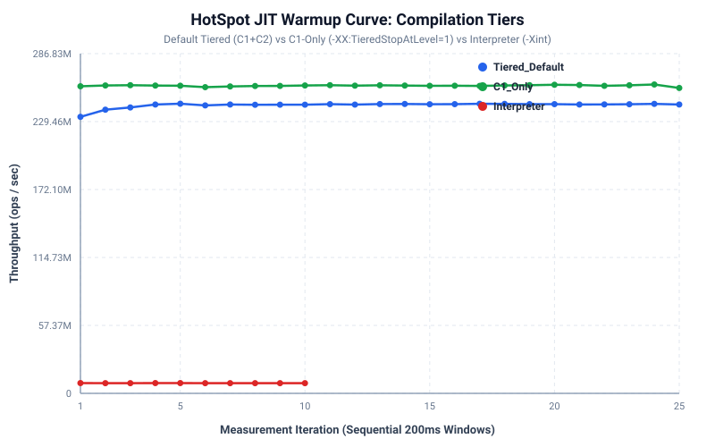

# Empirical Performance Results (`RESULTS.md`)

> Auto-generated by `scripts/report.py` directly from raw experiment artifacts.

## 1. Benchmarking Environment
- **CPU / Hardware**: Apple M1 Pro (arm64), 8 cores, 16 GB RAM
- **Operating System**: macOS 15.3.2 (24D81) (Kernel: 24.3.0)
- **JDK Vendor & Version**: Amazon.com Corretto 21.0.12.1 (`OpenJDK 64-Bit Server VM`)
- **Profiling Engine**: Async-profiler 4.5 built on Jul 13 2026
- **Timestamp**: 2026-10-16T06:34:16Z

## 2. HotSpot C2 Escape Analysis & Scalar Replacement
Evaluates `EscapeAnalysisCase` with default C2 Escape Analysis (`-XX:+DoEscapeAnalysis`) vs EA disabled (`-XX:-DoEscapeAnalysis`).

| Benchmark Variant | JVM Flags | Throughput (ops/s) | Error (±) | Alloc Rate (B/op) | Source |
| :--- | :--- | :---: | :---: | :---: | :--- |
| `noEscape` | Default (`+DoEscapeAnalysis`) | 774,147.54 | ±13,717.22 | 0.009 | `results/raw/jmh/ea_default.json` |
| `noEscape` | `-XX:-DoEscapeAnalysis` | 259,108.09 | ±2,493.94 | 48,000.027 | `results/raw/jmh/ea_disabled.json` |
| `withEscape` (heap sink) | Default (`+DoEscapeAnalysis`) | 258,234.12 | ±4,701.41 | 48,000.027 | `results/raw/jmh/ea_default.json` |

## 3. HotSpot C2 Inlining and Polymorphic Dispatch
Evaluates composed small methods (<35 bytes) vs un-inlinable large method (>325 bytes bytecode), along with Monomorphic vs Megamorphic (4 receiver classes) call site dispatch.

| Experiment | Configuration | Throughput (ops/s) | Error (±) | Alloc Rate (B/op) | Source |
| :--- | :--- | :---: | :---: | :---: | :--- |
| Small Methods (<35B) | Default Inlining | 227,096.90 | ±2,254.94 | 0.031 | `results/raw/jmh/inlining_default.json` |
| Small Methods (<35B) | `-XX:-Inline` | 171,648.23 | ±6,342.76 | 0.041 | `results/raw/jmh/inlining_disabled.json` |
| Small Methods (<35B) | MaxInline=100, FreqInline=500 | 227,252.93 | ±1,913.95 | 0.031 | `results/raw/jmh/inlining_thresholds.json` |
| Large Method (>325B) | Default Inlining | 197,757.19 | ±2,265.18 | 0.035 | `results/raw/jmh/inlining_default.json` |
| Large Method (>325B) | `-XX:-Inline` | 181,317.84 | ±1,493.84 | 0.039 | `results/raw/jmh/inlining_disabled.json` |
| Large Method (>325B) | MaxInline=100, FreqInline=500 | 227,089.75 | ±616.51 | 0.031 | `results/raw/jmh/inlining_thresholds.json` |
| Monomorphic Call Site | Default Inlining | 3,191,723.27 | ±18,256.81 | 0.002 | `results/raw/jmh/inlining_default.json` |
| Monomorphic Call Site | `-XX:-Inline` | 1,001,853.35 | ±1,505.87 | 0.007 | `results/raw/jmh/inlining_disabled.json` |
| Monomorphic Call Site | MaxInline=100, FreqInline=500 | 3,175,985.80 | ±31,411.67 | 0.002 | `results/raw/jmh/inlining_thresholds.json` |
| Megamorphic Call Site (4 types) | Default Inlining | 306,428.56 | ±14,855.34 | 0.023 | `results/raw/jmh/inlining_default.json` |
| Megamorphic Call Site (4 types) | `-XX:-Inline` | 316,930.83 | ±381.68 | 0.022 | `results/raw/jmh/inlining_disabled.json` |
| Megamorphic Call Site (4 types) | MaxInline=100, FreqInline=500 | 301,952.98 | ±14,403.65 | 0.023 | `results/raw/jmh/inlining_thresholds.json` |

## 4. Garbage Collection Comparative Matrix
Execution of `GcHarness` under identical allocation pressure across all verified HotSpot collectors at fixed 512m and 2g heaps.

| Collector | Heap | Reps | Throughput (ops/s) | GC Overhead (%) | p50 Pause (ms) | p95 Pause (ms) | p99 Pause (ms) | Max Pause (ms) | Peak Heap (MB) |
| :--- | :---: | :---: | :---: | :---: | :---: | :---: | :---: | :---: | :---: |
| `G1` | 2g | 3 | 77,344.4 | 0.906% | 3.122 | 4.514 | 4.875 | 5.627 | 1229.0 |
| `G1` | 512m | 3 | 76,167.9 | 2.796% | 2.506 | 2.869 | 3.064 | 34.028 | 308.0 |
| `Parallel` | 2g | 3 | 76,214.7 | 2.320% | 4.685 | 6.151 | 6.839 | 15.695 | 664.0 |
| `Parallel` | 512m | 3 | 71,841.0 | 7.282% | 3.583 | 5.040 | 6.337 | 46.760 | 502.0 |
| `Serial` | 2g | 3 | 73,088.1 | 6.301% | 10.951 | 12.820 | 17.138 | 234.876 | 566.0 |
| `Serial` | 512m | 3 | 68,944.2 | 12.878% | 5.357 | 5.981 | 59.927 | 84.494 | 491.0 |
| `Shenandoah` | 2g | 3 | 77,416.7 | 0.048% | 0.042 | 0.159 | 0.192 | 0.295 | 1775.0 |
| `Shenandoah` | 512m | 3 | 73,447.0 | 0.211% | 0.036 | 0.202 | 0.219 | 0.289 | 455.0 |
| `ZGC` | 2g | 3 | 77,820.1 | 0.004% | 0.005 | 0.011 | 0.019 | 0.030 | 1862.0 |
| `ZGC` | 512m | 3 | 77,594.3 | 0.017% | 0.004 | 0.011 | 0.012 | 0.036 | 370.0 |
| `ZGC_Gen` | 2g | 3 | 77,166.9 | 0.005% | 0.007 | 0.011 | 0.014 | 0.021 | 1914.0 |
| `ZGC_Gen` | 512m | 3 | 76,314.2 | 0.019% | 0.005 | 0.009 | 0.012 | 0.778 | 364.0 |

## 5. JIT Compilation Diagnostics
- **Total Compilations**: 147 (C1 Tier 3: 106, C2 Tier 4: 19, OSR: 8)
- **Inlining Decisions**: 267 inlined, 121 rejected (`callee is too large` / `hot method too big`), 0 polymorphic virtual dispatches.

## 6. Execution Profiling: Top Self-Time Frames
### CPU-Bound Workload (`PointerChasing`)
| Rank | Frame / Method | Samples | Self % | Cumulative % |
| :---: | :--- | :---: | :---: | :---: |
| 1 | `lab.workload.PointerChasing.traverse` | 1784 | 96.59% | 96.59% |
| 2 | `__psynch_cvwait` | 32 | 1.73% | 98.32% |
| 3 | `java.util.concurrent.atomic.LongAdder.add` | 4 | 0.22% | 98.54% |
| 4 | `Monitor::wait_without_safepoint_check` | 2 | 0.11% | 98.65% |

### Allocation-Heavy Workload (`AllocationHeavy`)
| Rank | Frame / Allocated Type | Samples | Self % | Cumulative % |
| :---: | :--- | :---: | :---: | :---: |
| 1 | `byte[]` | 90709 | 89.89% | 89.89% |
| 2 | `lab.workload.AllocationHeavy$ShortLivedPayload` | 10195 | 10.10% | 100.00% |

## 7. JIT Warmup Curve

